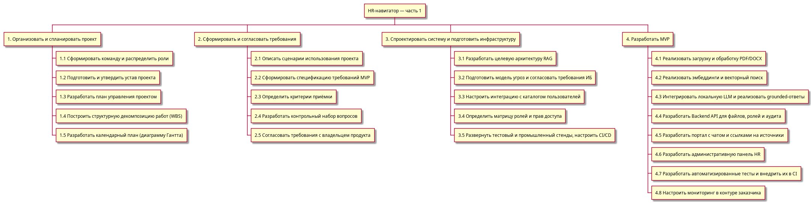
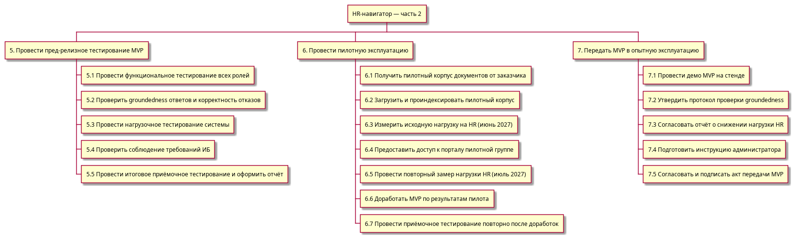

# Задание КЗ_4 Структурная декомпозиция (WBS)

**Название команды:** HR-навигатор

**Состав команды:**

1. Кочергин Вячеслав Юрьевич
2. Власенко Даниил Сергеевич
3. Козырева Софья Александровна
4. Котельникова Ксения Андреевна

**Формулировка задания:**

Создать структурную декомпозицию работ выбранного проекта. Можно использовать графические инструменты или просто многоуровневый список.

---

### Диаграмма WBS — часть 1

### Диаграмма WBS — часть 2

