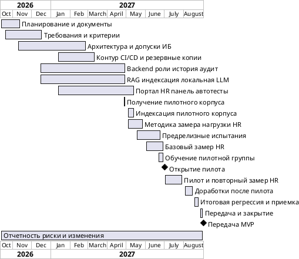

# Задание КЗ_5 Оценка проекта

**Название команды:** HR-навигатор

**Состав команды:**

1. Кочергин Вячеслав Юрьевич
2. Власенко Даниил Сергеевич
3. Козырева Софья Александровна
4. Котельникова Ксения Андреевна

**Формулировка задания:**

Выполнить оценку выбранного проекта: объем (методом экспертной оценки и UCP, сравнить полученные оценки и прокомментировать если они отличаются более, чем на 30%), трудоемкость, продолжительность (с помощью диаграммы Гантта), стоимость работы.

---

# Оценка проекта

## 1. О документе

### 1.1. Исходные ограничения и допущения

| Параметр | Значение / основание |
|---|---|
| Начало проекта | 12.10.2026, дата утверждения устава |
| Передача MVP | Не позднее 01.09.2027 |
| Бюджет внедрения | 22,8 млн ₽ |
| Доступность команды | До 6,5 эквивалента полной занятости (FTE) |
| Пилотный корпус | Заказчик передаёт до 01.05.2027, для планирования принято 30.04.2027 |
| Базовый замер нагрузки HR | Июнь 2027 года |
| Открытие портала пилотной группе | 01.07.2027 |
| Повторный замер нагрузки HR | Июль 2027 года |
| Качество ответов | Не менее 95 % grounded-ответов по контрольному набору |
| Эффект пилота | Сокращение времени HR на рутинные консультации не менее чем на 30 % |
| Инфраструктура | Тестовый стенд и пилотный контур в инфраструктуре заказчика; промышленный кластер не создаётся |
| Учёт рабочего времени | 8 часов в рабочий день, 160 часов в условный человеко-месяц; праздничные дни отдельно не исключены |

### 1.2. Термины

| Термин | Определение |
|---|---|
| Экспертная оценка | Определение трудоёмкости работ по оценкам участников команды с учётом неопределённости |
| PERT | Трёхточечная оценка: оптимистическая, наиболее вероятная и пессимистическая |
| Вес | Условная числовая оценка сложности элемента системы. В методе UCP вес назначается действующим лицам в зависимости от способа взаимодействия с системой, а вариантам использования — в зависимости от количества шагов. |
| UAW (Unadjusted Actor Weight) | Сумма весов всех действующих лиц системы. |
| UUCW (Unadjusted Use Case Weight) | Сумма весов всех вариантов использования системы. |
| TCF | Коэффициент технической сложности |
| ECF | Коэффициент сложности среды разработки |
| UCP | Скорректированное количество баллов вариантов использования |
| FTE | Эквивалент полной занятости одного исполнителя |
| Groundedness | Обоснованность ответа фрагментами индексированного корпуса документов |

## 3. Экспертная оценка объёма функциональной части

### 3.1. Метод

Функциональная часть оценена методом PERT. Для каждого пакета работ заданы три оценки в человеко-часах: `a` — оптимистическая, `m` — наиболее вероятная, `b` — пессимистическая. Расчётная трудоёмкость:

`E = (a + 4 × m + b) / 6`.

В оценку включены реализация пользовательских функций MVP, их интеграция, автоматизированные проверки и исправление дефектов, выявленных при пилоте. Управление проектом, подготовка инфраструктуры, формальные согласования, нагрузочные и ИБ-испытания и организация пилота дополнительно учитываются в разделе 5. Это разграничение необходимо для корректного сравнения с UCP.

### 3.2. Расчёт по пакетам работ

| Пакет работ | WBS | a, ч | m, ч | b, ч | E, ч |
|---|---|---:|---:|---:|---:|
| Авторизация и интеграция с корпоративным каталогом | 3.4, 4.4 | 120 | 180 | 240 | 180,0 |
| Загрузка, обработка документов и индексация | 4.1–4.2 | 360 | 530 | 760 | 540,0 |
| Локальная LLM, поиск контекста, grounded-ответы и отказы | 4.3 | 380 | 570 | 820 | 580,0 |
| Backend API, роли, история запросов и аудит | 4.4 | 260 | 390 | 580 | 400,0 |
| Портал: чат, история и ссылки на источники | 4.5 | 260 | 390 | 580 | 400,0 |
| HR-панель и управление документами | 4.6 | 170 | 260 | 390 | 266,7 |
| Сквозная интеграция и реализация ограничений доступа | 3.5, 4.1–4.6 | 320 | 490 | 730 | 501,7 |
| Автотесты в CI и функциональные проверки | 4.7, 5.1 | 480 | 680 | 1000 | 700,0 |
| Исправления по результатам пилота и повторные прогоны | 6.6, 7.1 | 320 | 480 | 740 | 496,7 |
| Итого по функциональной части | | **2670** | **3970** | **5840** | **4065,0** |

Экспертная оценка функциональной реализации составляет 4065 человеко-часов (около 25,4 человеко-месяца). Это ожидаемое значение по PERT, основанное на предварительных допущениях о сложности работ, поэтому оно подлежит уточнению после согласования требований и первых интеграционных проверок.

## 4. Оценка методом Use Case Points

### 4.1. Методика и границы расчёта

Использованы веса: простой актор (открытый API) — 1, средний (протокол) — 2, сложный (GUI) — 3; простой вариант использования (1–3 шага) — 5, средний (4–7 шагов) — 10, сложный (от 8 шагов) — 15. При подсчёте шагов учитываются самостоятельные действия пользователя и ответные транзакции системы, не мелкие технические операции внутри алгоритма.

Формулы:

`UUCP = UAW + UUCW`  
`TCF = 0,6 + 0,01 × Σ(вес T × оценка T)`  
`ECF = 1,4 − 0,03 × Σ(вес E × оценка E)`  
`UCP = UUCP × TCF × ECF`  
`Трудоёмкость UCP = UCP × X`, где `X = 25 ч/UCP`.

### 4.2. Акторы и UAW

| Актор | Взаимодействие | Тип | Вес |
|---|---|---|---:|
| Сотрудник банка | Веб-портал и чат | Сложный, GUI | 3 |
| HR-администратор | Веб-панель документов | Сложный, GUI | 3 |
| Системный администратор | Интерфейс управления доступом и аудитом | Сложный, GUI | 3 |
| Корпоративный каталог пользователей | Обмен по сетевому протоколу аутентификации | Средний, протокол | 2 |
| Итого UAW | | | **11** |

### 4.3. Варианты использования и UUCW

| Код | Вариант использования | Актор | Шагов (оценка) | Класс | Вес |
|---|---|---|---:|---|---:|
| UC-01 | Войти в портал через корпоративную авторизацию | Сотрудник / администратор | 3 | Простой | 5 |
| UC-02 | Задать вопрос и получить grounded-ответ либо обоснованный отказ | Сотрудник | 9 | Сложный | 15 |
| UC-03 | Просмотреть историю своих запросов | Сотрудник | 4 | Средний | 10 |
| UC-04 | Открыть документ или фрагмент-источник ответа | Сотрудник | 3 | Простой | 5 |
| UC-05 | Загрузить текстовый PDF/DOCX | HR-администратор | 6 | Средний | 10 |
| UC-06 | Запустить переиндексацию изменённых документов | HR-администратор | 8 | Сложный | 15 |
| UC-07 | Просмотреть и изменить состав корпуса документов | HR-администратор | 5 | Средний | 10 |
| UC-08 | Проверить состояние обработки документов | HR-администратор | 3 | Простой | 5 |
| UC-09 | Назначить и изменить права доступа пользователей | Системный администратор | 8 | Сложный | 15 |
| UC-10 | Просмотреть записи журнала аудита | Системный администратор | 5 | Средний | 10 |
| Итого UUCW | | | | | **100** |

Получено 3 простых варианта (3 × 5 = 15), 4 средних (4 × 10 = 40) и 3 сложных (3 × 15 = 45). UUCW = 100. Отказ при отсутствии источника считается альтернативным потоком UC-02, поэтому не прибавляется второй раз.

### 4.4. Технические факторы TCF

Шкала влияния фактора — от 0 (не влияет) до 5 (максимальное влияние).

| Код | Фактор | Вес | Оценка | Произведение |
|---|---|---:|---:|---:|
| T1 | Распределённость компонентов | 2 | 4 | 8,0 |
| T2 | Требования к производительности | 1 | 4 | 4,0 |
| T3 | Эффективность работы пользователя | 1 | 3 | 3,0 |
| T4 | Сложность внутренней обработки | 1 | 5 | 5,0 |
| T5 | Повторное использование компонентов | 1 | 2 | 2,0 |
| T6 | Простота установки | 0,5 | 3 | 1,5 |
| T7 | Удобство использования | 0,5 | 4 | 2,0 |
| T8 | Переносимость решения | 2 | 1 | 2,0 |
| T9 | Изменяемость | 1 | 3 | 3,0 |
| T10 | Параллельная работа пользователей | 1 | 3 | 3,0 |
| T11 | Требования к безопасности | 1 | 5 | 5,0 |
| T12 | Доступ внешних систем | 1 | 1 | 1,0 |
| T13 | Особые требования к обучению | 1 | 3 | 3,0 |
| Итого | | | | **42,5** |

Высокие оценки T4 и T11 отражают особенности RAG и требования банка к изоляции данных и доступу. Низкая оценка T8 обусловлена развёртыванием в одном согласованном контуре.

`TCF = 0,6 + 0,01 × 42,5 = 1,025`.

### 4.5. Факторы среды ECF

| Код | Фактор | Вес | Оценка | Произведение |
|---|---|---:|---:|---:|
| E1 | Знакомство команды с формальным процессом разработки | 1,5 | 3 | 4,5 |
| E2 | Опыт в прикладной области | 0,5 | 3 | 1,5 |
| E3 | Опыт объектно-ориентированной разработки | 1 | 4 | 4,0 |
| E4 | Квалификация ведущего аналитика | 0,5 | 4 | 2,0 |
| E5 | Мотивация команды | 1 | 4 | 4,0 |
| E6 | Стабильность требований | 2 | 3 | 6,0 |
| E7 | Использование сотрудников с частичной занятостью | −1 | 4 | −4,0 |
| E8 | Сложность применяемых языков и технологий | −1 | 3 | −3,0 |
| Итого | | | | **15,0** |

По E7 учтены частично занятые архитектор, аналитик, DevOps-, QA- и ИБ-специалист. Значения факторов среды заданы экспертно и должны быть уточнены при назначении исполнителей.

`ECF = 1,4 − 0,03 × 15,0 = 0,950`.

### 4.6. Итог расчёта UCP

| Показатель | Расчёт | Значение |
|---|---|---:|
| UAW | 3 + 3 + 3 + 2 | 11 |
| UUCW | 15 + 40 + 45 | 100 |
| UUCP | 11 + 100 | 111 |
| TCF | 0,6 + 0,01 × 42,5 | 1,025 |
| ECF | 1,4 − 0,03 × 15 | 0,950 |
| UCP | 111 × 1,025 × 0,950 | 108,086 |
| X | Принято в пределах 20–30 ч/UCP | 25 ч/UCP |
| Трудоёмкость по UCP | **108,08625 × 25** | **2702 ч** |

## 5. Сопоставление методов и общая трудоёмкость

### 5.1. Сравнение функциональной части

| Показатель | Трудоёмкость |
|---|---:|
| Экспертная оценка PERT | 4065 ч |
| Оценка UCP при X = 25 ч/UCP | 2702 ч |
| Абсолютное отклонение | 1363 ч |
| Отклонение относительно UCP | 50,4 % |
| Отклонение относительно экспертной оценки | 33,5 % |

Отклонение относительно UCP рассчитано как `|4065 − 2702,156| / 2702,156 × 100 % = 50,4 %`. Оно превышает порог 30 %, указанный в задании.

Вероятные причины расхождения: UC-02 и UC-06 отражают сложные RAG-операции, однако их вес ограничен 15 баллами независимо от объёма настройки локальной модели, оценки качества и переиндексации. Метод UCP чувствителен к числу шагов, а экспертная оценка дополнительно отражает интеграционную неопределённость, тестовый контур и доработки по результатам пилота. Коэффициент `X = 25` выбран предварительно и не откалиброван по истории аналогичных проектов.

Для планирования принята экспертная оценка **4065 ч** как более осторожная. UCP оставлен в качестве независимой контрольной оценки функциональной части. Полученные значения не складываются.

### 5.2. Трудоёмкость работ за пределами функциональной оценки

| Группа работ | WBS | Трудоёмкость, ч |
|---|---|---:|
| Управление проектом, отчётность, изменения и риски | 1 | 1700 |
| Сбор и согласование требований, контрольный набор | 2 | 680 |
| Архитектура, допуски, пилотный контур, бэкапы и эксплуатационная подготовка | 3 | 780 |
| Нефункциональные испытания, безопасность и итоговая проверка готовности | 5.2–5.4, 7.2–7.6 | 950 |
| Подготовка пилота, методика и замеры, обучение пользователей | 4.10–4.11, 6 | 365 |
| Оформление передачи и закрытие проекта | 7 | 130 |
| Итого дополнительные работы | | **4605** |

Группы дополнительных работ не включают трудозатраты на функции и их автоматизированное тестирование, уже учтённые в экспертной оценке раздела 3. Взаимные границы пакетов уточняются при назначении ответственных.

Общая трудоёмкость проекта = 4065 + 4605 = 8670 человеко-часов, или 54,2 условного человеко-месяца при 160 часах в месяц.

### 5.3. Распределение трудоёмкости по ролям

| Роль | Занятость по плану | Плановые часы | Доступная ёмкость за срок, ч |
|---|---:|---:|---:|
| Руководитель проекта | 100 % | 1520 | 1864 |
| Архитектор | 50 % | 700 | 932 |
| Бизнес-аналитик | 75 % | 960 | 1398 |
| ML-инженер | 100 % | 1400 | 1864 |
| Backend-разработчик | 100 % | 1250 | 1864 |
| Frontend-разработчик | 100 % | 1220 | 1864 |
| DevOps-инженер | 50 % | 680 | 932 |
| QA-инженер | 50 % | 640 | 932 |
| Специалист по ИБ | 25 % | 300 | 466 |
| Итого | **6,5 FTE** | **8670** | **12116** |

Для грубой проверки ёмкости взят период с 12.10.2026 по 01.09.2027 включительно — 233 будних дня без отдельного исключения государственных праздников. Общая теоретическая ёмкость: `233 × 8 × 6,5 = 12 116 ч`. Плановая загрузка — около 71,6 % от этой границы. Остаток представляет собой резерв доступности и периоды, когда роли не заняты в проекте, и не включён в оплачиваемую оценку 8670 ч.

## 6. Продолжительность и календарный план

### 6.1. Основные зависимости

1. Допуск команды к контуру и согласование требований ИБ выполняются до настройки пилотной инфраструктуры и работы с внутренними документами.
2. Механизмы загрузки, индексации и grounded-ответов разрабатываются на разрешённых тестовых документах. Корпус заказчика передаётся до 01.05.2027, после чего выполняется его индексация.
3. Предрелизные groundedness- и нагрузочные испытания на пилотном корпусе проводятся **после** индексации корпуса.
4. Методика измерения нагрузки HR утверждается до первого замера в июне. Обучение пилотной группы проводится перед открытием портала.
5. Повторный замер выполняется в июле, доработки — в августе. Итоговая регрессия и оформление приёмки завершаются до 01.09.2027.
6. Автотесты подключаются к CI по мере разработки компонентов. Непрерывные управленческие работы охватывают весь календарный период.

### 6.2. Календарные сроки

| Пакет работ / событие | Начало | Завершение | Результат |
|---|---|---|---|
| Планирование и исходные документы | 12.10.2026 | 13.11.2026 | Устав, план, WBS, оценка и график |
| Согласование требований и контрольных вопросов | 19.10.2026 | 18.12.2026 | Согласованная спецификация |
| Архитектура и допуски ИБ | 09.11.2026 | 26.02.2027 | Архитектура и разрешённые доступы |
| Тестовый стенд, пилотный контур, CI/CD и бэкапы | 11.01.2027 | 12.03.2027 | Подготовленная инфраструктура |
| Backend, каталог, роли, история и аудит | 14.12.2026 | 30.04.2027 | Работающие серверные функции |
| RAG, обработка документов и локальная LLM | 14.12.2026 | 30.04.2027 | Индексация и grounded-ответы |
| Портал, HR-панель, автотесты и мониторинг | 11.01.2027 | 14.05.2027 | Интегрированная сборка MVP |
| Получение корпуса заказчика | 26.04.2027 | 30.04.2027 | Принятый пилотный корпус |
| Индексация пилотного корпуса | 03.05.2027 | 14.05.2027 | Индекс версии пилотного корпуса |
| Разработка методики замера | 03.05.2027 | 28.05.2027 | Согласованная методика |
| Предварительные испытания на корпусе | 17.05.2027 | 25.06.2027 | Отчёт о готовности к пилоту |
| Базовый замер нагрузки HR | 01.06.2027 | 30.06.2027 | Исходные показатели |
| Обучение пилотной группы | 21.06.2027 | 30.06.2027 | Обученные пользователи |
| Открытие портала пилотной группе | 01.07.2027 | 01.07.2027 | Доступ пилотной группы |
| Пилот и повторный замер нагрузки HR | 01.07.2027 | 30.07.2027 | Отчёт об эффекте |
| Исправления по результатам пилота | 02.08.2027 | 16.08.2027 | Доработанная сборка |
| Итоговая регрессия и приёмочные проверки | 17.08.2027 | 25.08.2027 | Протоколы качества и ИБ |
| Демонстрация, документы передачи и закрытие | 26.08.2027 | 01.09.2027 | Акт, инструкция, итоговый отчёт |
| Отчётность, риски и управление изменениями | 12.10.2026 | 01.09.2027 | Отчёты и актуальные реестры |

### 6.3. Диаграмма Гантта (PlantUML)

Диаграмма отражает перекрывающиеся работы и контрольные даты. При переносе диаграммы в инструмент календарного планирования понадобится учесть праздничные дни и фактическую доступность участников.

### 6.4. Итог по продолжительности

Календарная продолжительность проекта — с 12 октября 2026 года по 1 сентября 2027 года включительно, всего 325 календарных дней, около 10,7 календарного месяца. Реализация укладывается в дату передачи из устава при условии своевременного предоставления корпуса, допусков ИБ и вычислительных ресурсов.

Особенно чувствительный участок — передача корпуса 30.04.2027 → индексация до 14.05.2027 → предрелизные испытания с 17.05.2027 → открытие пилота 01.07.2027. Сдвиг передачи корпуса сокращает время испытаний и может потребовать пересмотра графика.

## 7. Стоимость работ и бюджет проекта

### 7.1. Метод расчёта

Стоимость труда рассчитана ресурсным методом: `стоимость роли = плановые часы × расчётная полная ставка за час`. Ставка включает условные затраты подрядчика на специалиста и связанные накладные расходы. Часы относятся к объёму 8670 ч, полученному в разделе 5.

### 7.2. Стоимость труда по ролям

| Роль | Часы | Ставка, ₽/ч | Стоимость, ₽ |
|---|---:|---:|---:|
| Руководитель проекта | 1520 | 2200 | 3 344 000 |
| Архитектор | 700 | 2500 | 1 750 000 |
| Бизнес-аналитик | 960 | 1900 | 1 824 000 |
| ML-инженер | 1400 | 2300 | 3 220 000 |
| Backend-разработчик | 1250 | 2100 | 2 625 000 |
| Frontend-разработчик | 1220 | 1900 | 2 318 000 |
| DevOps-инженер | 680 | 2200 | 1 496 000 |
| QA-инженер | 640 | 1600 | 1 024 000 |
| Специалист по ИБ | 300 | 2300 | 690 000 |
| Итого | **8670** | | **18 291 000** |

Расчётная стоимость работы команды составляет 18,291 млн ₽. Средняя полная часовая стоимость — около 2110 ₽/ч. Предусмотренная командой часть работы по проведению обучения уже включена в трудозатраты соответствующих ролей и вторично в отдельную статью труда не добавляется.

### 7.3. Полный бюджет внедрения

| Статья | Сумма, ₽ | Пояснение |
|---|---:|---|
| Работа команды | 18 291 000 | По расчёту п. 7.2 |
| Эксплуатационные ресурсы пилотного контура | 1 300 000 | Резервирование вычислительных ресурсов, хранение, пилотная инфраструктура без приобретения промышленного кластера |
| Инструменты и технические расходы на испытания | 500 000 | Тестовая инфраструктура, вспомогательное ПО и расходные затраты; условная оценка |
| Обучение пилотной группы | 600 000 | Материалы, организация обучения и сопутствующие расходы; время штатной команды учтено в трудозатратах |
| Резерв проекта | 2 109 000 | На риски интеграции, дополнительные проверки и непредвиденные затраты |
| Итого | **22 800 000** | Совпадает с бюджетным ограничением устава |

### 7.4. Анализ выполнимости бюджета

Расчётная стоимость труда составляет 80,2 % общего бюджета. На нетрудовые расходы и резерв приходится 4,509 млн ₽ (19,8 %). Запланированная сумма 22,8 млн ₽ не превышает ограничения. При этом резерв 2,109 млн ₽ не компенсирует автоматически срыв календарных сроков: его использование и возможная перераспределённость ресурсов должны быть отдельно согласованы.

## 8. Итоги оценки

| Показатель | Итог |
|---|---|
| Объём функциональной реализации: экспертная оценка | 4065 ч |
| Объём функциональной реализации: UCP | 108,086 UCP, или 2702 ч при 25 ч/UCP |
| Расхождение оценок | 50,4 % относительно UCP; требуется пояснение, приведено в п. 5.1 |
| Выбранная база для планирования | Экспертная оценка функциональной части |
| Полная трудоёмкость проекта | 8670 ч, или 54,2 человеко-месяца |
| Доступная численность команды | До 6,5 FTE |
| Продолжительность | 12.10.2026–01.09.2027, 325 календарных дней |
| Расчётная стоимость труда | 18,291 млн ₽ |
| Полный бюджет проекта | 22,8 млн ₽ |
| Ключевые контрольные события | Корпус до 01.05.2027, пилот с 01.07.2027, передача 01.09.2027 |

Полученная оценка носит предварительный характер. При завершении проектирования следует уточнить сценарии и их шаги, откалибровать показатель человеко-часов на UCP по аналогам, уточнить трудозатраты на RAG и испытания, ставки исполнителей, стоимость пилотных вычислительных ресурсов и праздничные дни в календаре. Эти изменения оформляются по принятой процедуре управления конфигурацией проекта.

